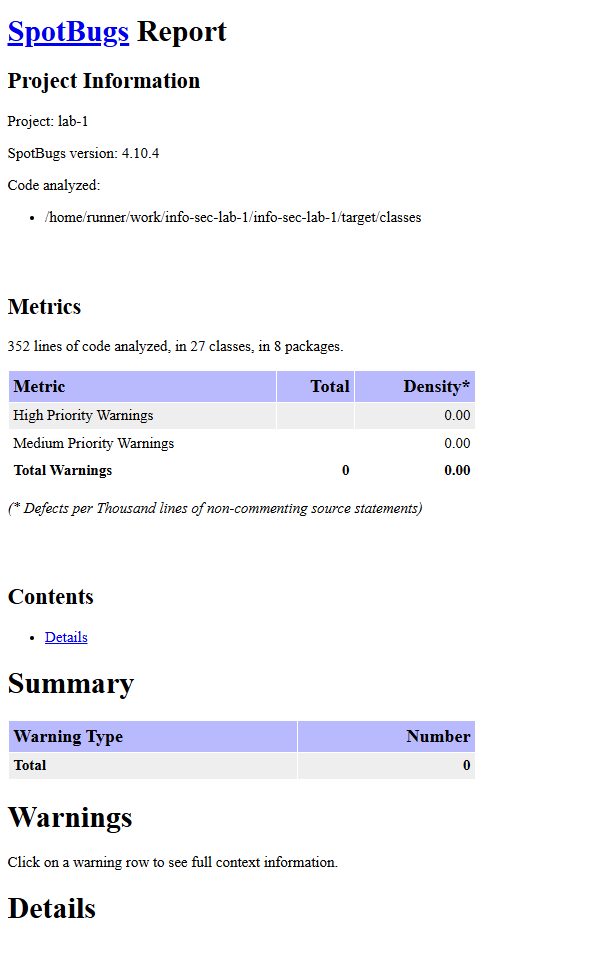
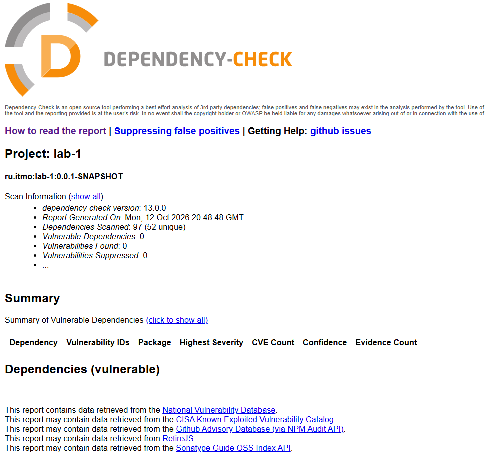

# Защищённый REST API

Стек:
- Java 17
- Spring Boot
- Spring Data JPA и Hibernate
- PostgreSQL

## API

API поддерживает аутентификацию по JWT, получение записей пользователя и создание новых записей.

| Метод | Путь | Доступ | Назначение |
| --- | --- | --- | --- |
| `POST` | `/auth/login` | публичный | Проверяет логин и пароль, возвращает JWT |
| `GET` | `/api/data` | Bearer JWT | Возвращает записи текущего пользователя |
| `POST` | `/api/data` | Bearer JWT | Создаёт запись с полями `title` и `content` |

Команды для ручных тестов приведены в [docs/tests.md](docs/tests.md).

## Реализованные меры защиты

### SQL-инъекции

Доступ к PostgreSQL реализован через Spring Data JPA и Hibernate. Значения передаются как параметры ORM-запросов и не объединяются с SQL-кодом строковой конкатенацией.

### XSS

Пользовательские `title` и `content` перед возвратом экранируются с помощью `HtmlUtils.htmlEscape`. HTML-теги и специальные символы возвращаются в виде HTML-сущностей.

### Аутентификация и авторизация

- После успешного входа выдаётся JWT с алгоритмом HS256 и сроком действия один час.
- Запросы к `/api/**` требуют заголовок `Authorization: Bearer <token>`.
- Подпись и срок действия токена проверяются для каждого защищённого запроса.
- Ошибки входа не раскрывают, существует ли пользователь.

### Хранение паролей

Пароли хранятся только как bcrypt-хэши. Открытый пароль используется только при проверке входа и не записывается в БД.

## CI/CD и security-сканирование

GitHub Actions запускается при `push` и `pull_request`:

- SAST: SpotBugs с плагином Find Security Bugs;
- SCA: OWASP Dependency-Check;
- отчёты сохраняются в артефакте `security-reports`.

Публичный репозиторий: https://github.com/ahmadeev/info-sec-lab-1.

Последний успешный запуск pipeline: https://github.com/ahmadeev/info-sec-lab-1/actions/runs/38304764004/job/114995999233.

### Результат SAST

### Результат SCA

